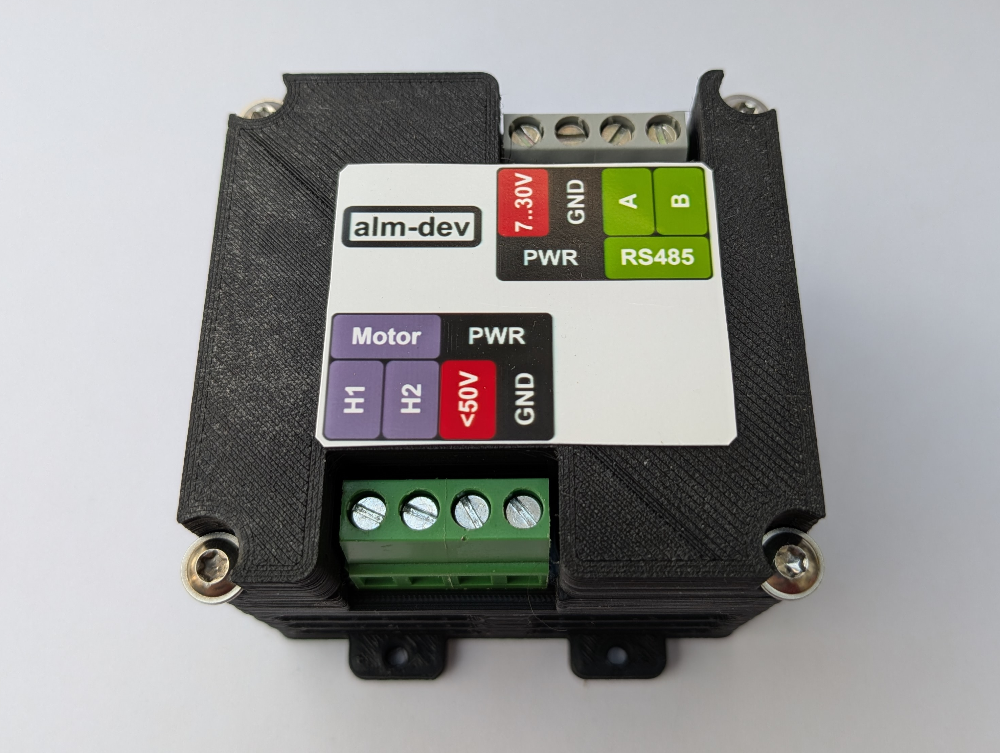

# MODBUS RTU RS485 40A H-Bridge Module

This H-Bridge module is designed for PWM-controlled DC motor, solenoid, valve, and other DC load applications. It communicates over RS485 using MODBUS RTU, making it easy to integrate into PLC, microcontroller, and PC-based systems without any proprietary protocol.

This 40A H-Bridge is suitable for driving brushed DC motors and other DC loads in industrial, automation, and robotics setups.

## Project folders

- `modbus-hbridge-fw` — Firmware source files for the device, including the embedded software project.  
License: Apache License 2.0.
- `modbus-hbridge-hw` — PCB design files, schematics, and board layout for the H-Bridge hardware.  
License: CERN Open Hardware Licence Version 2.
- `modbus-hbridge-3d` — 3D printable enclosure files and case models for the module.  
License: CERN Open Hardware Licence Version 2.

## Python library

Control the device using the Python library repository:
https://github.com/AlmCoding/modbus-py

## Purchase options

The device is available for purchase on Tindie:
https://www.tindie.com/products/almcoding/modbus-rtu-rs485-40a-h-bridge-module/
